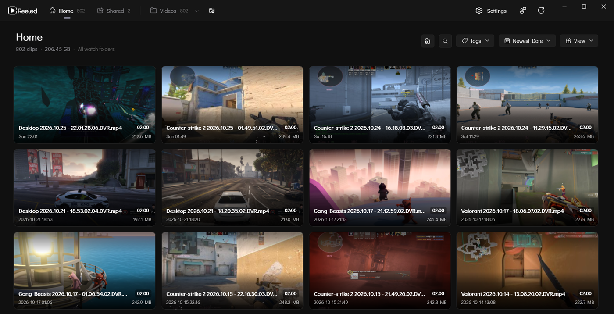
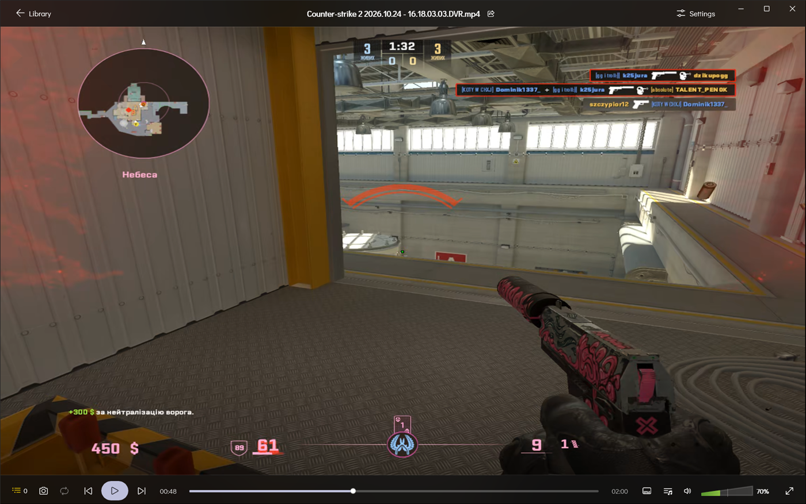
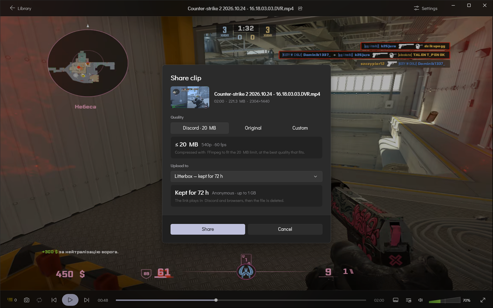

<p align="center">
  <picture>
    <source media="(prefers-color-scheme: dark)" srcset="Reeled/Assets/light-banner.svg">
    <source media="(prefers-color-scheme: light)" srcset="Reeled/Assets/dark-banner.svg">
    
  </picture>
</p>

<p align="center">
  A local video player and library manager for gameplay clips on Windows.
</p>

---

**Reeled** is a desktop player and organizer built for gameplay recordings (NVIDIA Shadowplay, OBS Studio, Medal, SteelSeries Moments, etc.). Instead of digging through folders or opening clips one-by-one in a generic video player, Reeled gives you a dedicated library to browse your recordings and a Direct3D11 player made for reviewing gameplay — with real-time timeline scrubbing, multi-audio track mixing, volume boost, and timestamp bookmarks.

Built with unpackaged WinUI 3 (Windows App SDK), .NET 8, and LibVLC 3.0.

<p align="center">
  
</p>

<p align="center">
  
  
</p>

<p align="center">
  <a href="https://github.com/k25jura/Reeled/releases/latest"><b>Download the latest release</b></a>
</p>

---

## Features

### Library & Folders
- **Folder Watching**: Add your recording directories (e.g. Shadowplay or OBS output folders). Newly recorded, renamed, or deleted clips update automatically.
- **Organization**: Filter clips by date, group by month, and search by title or tags.
- **Tags**: Label clips with your own tags, give tags and folders icons, and filter the library by tag or by game with searchable pickers.
- **Game Icons**: Game folders get their icon automatically from Steam, then SteamGridDB or IGDB if you add your own keys (only confident matches; can be turned off), or pick one yourself.
- **Tabs**: Keep several folders open side by side in tabs, reopened on the next start.
- **Grid or List**: Browse as cards or as a sortable details list.
- **File Management**: Select several clips, copy, cut and paste them (also to and from File Explorer), drag them onto folders or out to other apps, and create, rename or delete folders. Deletes always go to the Recycle Bin.
- **Favorites, Saved Moments and Shared**: Sections for clips you starred, clips with bookmarks, and clips you've shared, each shown always, only when not empty, or hidden.
- **Clip Context Menu**: View video metadata (resolution, bitrate, codecs, audio tracks), favorite clips, tag, rename, open in File Explorer, or delete to the Windows Recycle Bin.

### Sharing
- **Share in two clicks**: From a clip's menu or the player's title bar, send it compressed to fit Discord (20 MB, 50 MB with Nitro Basic, or any limit you set), as it is, or with your own resolution, frame rate and bitrate.
- **Only the loop**: With an A-B loop set, share just that part.
- **Where it goes**: Litterbox (deleted after 1 to 72 hours), Catbox (permanent), GoFile, PixelDrain with your API key, or just copy the video to paste into Discord. Links from Litterbox and Catbox play right in Discord.
- **Graphics card encoding**: Compression runs on NVIDIA, AMD or Intel encoders when available, with FFmpeg (installed for you through winget if you allow it).
- **Shared section**: Every share keeps its link, how long until it expires, and the compressed copy, with a badge on the clip. Copy a link again, open the original, or clean up the copies from Settings › Storage.
- **Player link**: Catbox and Litterbox shares also get a link to a clean browser player on the Reeled website.

### Customization
- **Accent Colour**: Follow Windows, pick a preset, or choose any colour.
- **Interface Size**: Scale the whole interface from 80% to 175% (`Ctrl` + `+` / `-` / `0`).
- **Navigation**: Put the navigation on any window edge and hide sections you don't use.
- **Player Toolbar**: Drag and drop the buttons you want, in a two-row or a one-row layout.
- **On-screen Display**: Choose its position, size, duration and backdrop.

### Video Player
- **Direct3D11 Playback**: Hardware-accelerated rendering powered by LibVLC 3.0.
- **Timeline Scrubbing**: Smooth video seeking while dragging the timeline slider.
- **Audio Control**: Multi-track audio switching, output device choice, volume boost above 100%, and scroll-wheel volume adjustment.
- **Session Settings**: Speed, repeat, A-B loop, picture adjustments, aspect ratio, a 10-band equalizer, audio and subtitle delay, and subtitle style in one panel.
- **Subtitles**: Load SRT, VTT or ASS files and style them live.
- **Playback Tools**: Frame-by-frame stepping, playback speed controls, snapshots, mini player, and repeat modes (off, loop one, loop all).
- **Clip Queue**: Quick slide-out drawer (`Q`) to switch, sort, shuffle or reorder clips without heading back to the library.
- **Right-click Menu**: Everything the player can do, one right-click away.
- **Background Music**: Spotify or any other app's music pauses while a clip plays and starts again when you're done (can be turned off).

### Moments & Bookmarks
- **Mark Highlights**: Press `B` during playback to mark a moment at the current timestamp.
- **Timeline Markers**: Bookmarked moments appear directly as tick markers on the seek bar.
- **Moments Drawer**: Open the slide-out drawer to review marks, rename descriptions, or jump between timestamps.

---

## Keyboard & Mouse Shortcuts

**Player**

| Input | Action |
| --- | --- |
| `Space` | Play / Pause |
| `Left` / `Right Arrow` | Seek backward / forward 5 seconds (5, 10, 15 or 30 in Settings) |
| `Shift + Left` / `Right Arrow` | Fine seek backward / forward 1 second |
| `,` / `.` | Step one frame backward / forward (pauses) |
| `Home` / `End` | Jump to start / end |
| `0` – `9` | Jump to 0% – 90% of the clip |
| `N` / `P` (or `Page Down` / `Page Up`) | Next / previous clip |
| `[` / `]` | Playback speed down / up 0.25x |
| `\` | Reset playback speed |
| `Up` / `Down Arrow` | Volume up / down 5% |
| `Mouse Scroll Wheel` | Volume adjust (over canvas or volume slider); can skip or do nothing instead |
| `M` | Toggle mute |
| `B` | Mark moment bookmark at current timestamp |
| `L` | A-B loop: set start, set end, clear |
| `H` | Hide the controls |
| `Q` | Toggle Clip Queue drawer |
| `R` | Cycle repeat mode (Off / All / One) |
| `S` | Stop playback |
| `Ctrl + O` | Open a video file |
| `F` or `F11` | Toggle fullscreen |
| `Double Click` (Canvas) | Toggle fullscreen |
| `Escape` | Exit fullscreen / Return to library |

**Library**

| Input | Action |
| --- | --- |
| `Ctrl + F` | Open search |
| `Ctrl + O` | Open a video file |
| `Ctrl + Click` / `Shift + Click` (clips) | Select clips / select a range |
| `Ctrl + A` / `Escape` | Select all clips / clear the selection |
| `Ctrl + C` / `Ctrl + X` / `Ctrl + V` | Copy / cut / paste clips (works with File Explorer too) |
| `Ctrl + Shift + N` | New folder |
| `Drag` (clips) | Move onto a folder (hold `Ctrl` to copy), or drag out to Explorer or Discord |
| `Ctrl + T` / `Ctrl + W` | New tab / close tab |
| `Ctrl + Tab` / `Ctrl + Shift + Tab` | Next / previous tab |
| `Ctrl + 1` – `9` | Go to tab 1–8 / last tab |
| `Middle Click` / `Ctrl + Click` (folder) | Open the folder in a new tab |
| `Ctrl + +` / `Ctrl + -` / `Ctrl + 0` | Interface size up / down / reset (works everywhere) |
| `Escape` (in search) | Clear search, press again to close it |
| `Right Click` (folder) | Open in a new tab, set a game icon, reveal in File Explorer, reorder or remove watch folders |
| `F5` | Rescan watch folders |
| `F2` | Rename the clip under the cursor (in app) |
| `Delete` | Move the clip under the cursor to the Recycle Bin (asks first) |
| `Middle Click` (clips) | Autoscroll |

---

## Tech Stack

- **UI Framework**: WinUI 3 (Windows App SDK 2.4) unpackaged
- **Runtime**: .NET 8 (`net8.0-windows10.0.26100.0`)
- **Architecture**: MVVM via `CommunityToolkit.Mvvm` with dependency injection
- **Video Engine**: `LibVLCSharp.WinUI` and native VideoLAN LibVLC 3.0 (Direct3D11 SwapChainPanel)
- **Thumbnails**: Windows Shell `StorageItemThumbnail` with persistent disk caching
- **Storage**: JSON storage for user settings, watched folders, and clip metadata

---

## Getting Started

### Prerequisites
- Windows 10 (version 1809 or newer) or Windows 11
- [.NET 8 SDK](https://dotnet.microsoft.com/download/dotnet/8.0) (or newer)

### Build and Run

1. Clone the repository:
   ```bash
   git clone https://github.com/k25jura/Reeled.git
   cd Reeled
   ```

2. Build the solution:
   ```bash
   dotnet build
   ```

3. Run the application:
   ```bash
   dotnet run --project Reeled\Reeled.csproj
   ```

---

## Feedback & Contributing

Found a bug or have an idea? Use **Send feedback** in the app (sidebar or Settings › About): it opens a pre-filled
[GitHub issue form](https://github.com/k25jura/Reeled/issues/new/choose) with your version and diagnostics.
See [CONTRIBUTING.md](CONTRIBUTING.md) to build Reeled and send changes, and [SECURITY.md](SECURITY.md) to report security issues privately.

---

## License

This project is licensed under the GPL-3.0 license. See the [LICENSE](LICENSE) file for details.
